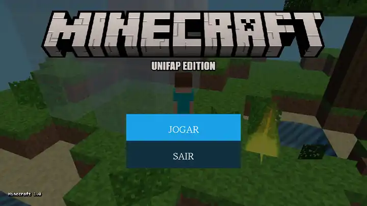

# minecraft-cg



Um jogo no estilo Minecraft feito em C com OpenGL, como material da disciplina de Computação Gráfica. Quase tudo usa o pipeline fixo; só a água e a fogueira usam shaders GLSL.

O código inteiro está em um único arquivo, [`mine.c`](mine.c), comentado para ser lido do começo ao fim. Ele é organizado em seções, nesta ordem:

| Seção | Conteúdo |
|---|---|
| Constantes | Tipos de bloco, tamanho do mundo, medidas do personagem e da câmera |
| Declarações antecipadas | Funções e variáveis usadas antes de serem definidas; servem de índice |
| TEXTURAS E TRANSPARÊNCIA | Tudo o que a aula de texturas trouxe, num bloco só: atlas, célula de cada face, faces ocultas, casinha de vidro, três passadas, plantas e itens como imagem |
| ILUMINAÇÃO FIXA E DEMONSTRAÇÃO | Luz, materiais, sombreamento e a demonstração isolada (tecla I) |
| TEXTURAS PROCEDURAIS E SHADERS GLSL | Texturas geradas no código (tecla X) e os shaders da água e do fogo |
| MUNDO | Mapa, matriz do mundo, construção e desenho dos blocos |
| COLISÃO | Posição do personagem, colisão com o mundo e física vertical |
| CÂMERA | Projeção, direção do olhar, primeira e terceira pessoa, desenho do personagem, céu, sol, lua e luz do dia |
| SELEÇÃO DE BLOCOS e EDIÇÃO DO MUNDO | Raio da mira, contorno, quebrar e colocar blocos |
| ITENS e INIMIGOS | Itens soltos e recolhidos; zumbis, dano e combate |
| DIA E NOITE | Quando é noite, a partir do ângulo do sol |
| ENTRADA | Teclado, mouse, roda e atualização do movimento |
| MENU | Estados do jogo, menu principal, pausa, instruções, barra de itens e informações em tela |
| MIRA E TÍTULO | Mira e título da janela |
| QUADRO E PROGRAMA PRINCIPAL | Desenho do quadro, FPS e `main` |

As funções centrais têm um comentário antes delas explicando o que fazem e por quê.

## O que tem no cenário

- Um terreno de 16 × 16 colunas de blocos.
- Uma montanha irregular com neve no topo.
- Um gramado com um laguinho.
- Uma praia e o mar.
- Uma árvore no formato do Minecraft, com as folhas vazadas.
- Uma casinha de vidro ao lado de onde o personagem começa.
- Duas nuvens.
- Um personagem no estilo do Minecraft, com braços e pernas que balançam ao andar.
- Plantas em planos cruzados espalhadas pelo gramado e uma fogueira animada.
- Um ciclo de dia e noite, com céu em domo, sol, lua e neblina.
- Iluminação com materiais, brilho especular e água com ondas animadas por shader.
- Itens soltos para recolher: uma muda, um bloco de terra e uma maçã, além dos que caem dos blocos quebrados.
- Zumbis que surgem à noite e perseguem o personagem.
- Um menu principal com os botões Jogar e Sair.
- Um menu de pausa (ESC) com os botões Continuar, Instruções e Sair.
- Uma mira no centro, uma barra de nove blocos com miniaturas 3D e a quantidade recolhida de cada um.
- Dez corações de vida acima da barra, como no Minecraft, com meio coração e contorno que pisca ao levar dano.
- Informações em tela: FPS, vida, dia ou noite e posição do personagem.

Tudo é feito com **um único cubo de lado 1**, desenhado várias vezes em posições diferentes. Os blocos do terreno são texturizados com um atlas pixelado; a água e o vidro são semitransparentes. Além dos blocos convencionais, o cenário possui elementos com formas de representação próprias. As plantas são desenhadas com dois planos texturizados cruzados, formando uma estrutura visível de diferentes ângulos. Os itens soltos no chão giram e flutuam: os que são blocos aparecem como cubos pequenos, e a muda e a maçã, como planos que acompanham a orientação horizontal da câmera (billboards).

A iluminação utiliza o sistema de iluminação do OpenGL, com luz direcional e ambiente que variam conforme a posição do sol, acompanhando o ciclo de dia e noite. Durante a noite, a iluminação direta assume a direção oposta, representando a luz da lua. A cor da neblina também acompanha as mudanças atmosféricas, enquanto o céu apresenta transições graduais entre as cores do horizonte e do zênite. Cada tipo de bloco tem um material (fosco ou polido, com brilho especular na água e no vidro), e a tecla O troca o sol por uma lâmpada pontual sobre o mapa. A superfície da água e a fogueira são animadas por shaders GLSL; a água também escurece à noite. As nuvens, o personagem e os zumbis continuam com cor sólida.

## Conteúdos por aula

| Semana | Conteúdo | Onde aparece no código |
|---|---|---|
| 1 | Janela, laço principal, tempo de quadro, FPS em tela, ESC | `main`, `desenha`, `atualiza` |
| 2 | Primitivas (`GL_QUADS`) e cor por face | `desenhaBloco`, `corDaFace` |
| 3 | Cubo 3D, buffer de profundidade, descarte de faces, instâncias com `glPushMatrix`/`glPopMatrix` | `desenhaBloco`, `blocoEm` |
| 4 | Perspectiva, correção de proporção, câmera com `gluLookAt`, navegação pelo teclado | `aplicaProjecao`, `redimensiona`, `posicionaCamera` |
| 5 | Teclado por estado e tempo de quadro; mouse com yaw e pitch e captura do cursor; matriz do mundo e colisão por caixa alinhada aos eixos; primeira e terceira pessoa; zoom pela roda | `teclado`, `tecladoSolto`, `atualiza`, `mundo`, `posicaoLivre`, `moveJogador`, `direcaoDoOlhar`, `movimentoMouse`, `posicionaCamera`, `desenhaJogador`, `rodaMouse` |
| Texturas e transparência | Atlas lido de um PPM e enviado com `glTexImage2D`; células por face e `glTexCoord2f`; filtro `GL_NEAREST` (visual pixelado) e `GL_MODULATE`; alfa por cor-chave; recorte com `GL_ALPHA_TEST` nas folhas; mistura com `GL_BLEND` e `glDepthMask` no vidro e na água, em três passadas, com os semitransparentes ordenados; faces ocultas por vizinho opaco | `lerPPM`, `converteRGBA`, `carregaAtlas`, `celulaDaFace`, `coordenadasDaCelula`, `desenhaBloco`, `faceVisivel`, `facesVisiveis`, `desenhaOpacos`, `listaTransparentes`, `desenhaTransparentes`, `casinhaEm` |
| 8 | Ciclo de dia e noite; interpolação de cores; iluminação direcional e ambiente; neblina dinâmica; domo celeste; sol e lua texturizados; itens como imagens que acompanham a câmera (billboards); vegetação com planos cruzados | `lerp`, `suave`, `direcaoDoSol`, `atualizaCeuELuz`, `carregaAstro`, `astro`, `desenhaDomo`, `desenhaItem`, `desenhaPlanta` |
| 9 | Seleção de blocos por percurso em grade (Amanatides e Woo) e contorno; quebrar e colocar blocos; itens soltos que caem e são recolhidos; gravidade, pulo e colisão vertical; inimigos que surgem à noite, perseguem, causam dano e são atacados (raio contra caixa) | `percursoEmGrade`, `atualizaMira`, `desenhaContorno`, `quebraBloco`, `colocaBlocoMirado`, `criaItem`, `atualizaItens`, `desenhaItens`, `moveCaixa`, `raioContraCaixa`, `atualizaInimigos`, `desenhaInimigo`, `ehNoite` |
| Iluminação e shaders | Componentes ambiente, difusa e especular; materiais foscos e polidos; normais por face e `GL_NORMALIZE`; sombreamento plano e Gouraud; luz pontual e direcional; demonstração isolada; texturas procedurais; água e fogo em GLSL | `inicializaIluminacao`, `atualizaComponentesLuz`, `aplicaMaterial`, `defineLuzDoCenario`, `desenhaDemonstracao`, `inicializaTexturas`, `inicializaShaders`, `desenhaAgua`, `desenhaFogo` |
| 10 | Passada 2D com as duas matrizes salvas; projeção em pixels; menu principal, jogo, pausa e instruções; cursor visível nos menus e capturado no jogo; botões com destaque e clique; mira, barra de nove itens com miniaturas 3D, quantidades, seleção por número ou roda; corações de vida; FPS, vida e posição em tela | `iniciaInterface`, `terminaInterface`, `desenhaInterface`, `desenhaBarraItens`, `desenhaCoracoes`, `desenhaInstrucoes`, `movimentoInterface`, `cliqueMouse`, `estadoJogo`, `botaoSelecionado` |

## Dependências

- Compilador C (`gcc`)
- OpenGL, GLU, GLUT (freeglut) e GLEW

É preciso usar a **freeglut**, não outra GLUT: a roda do mouse usa `glutMouseWheelFunc`, que é extensão da freeglut (testado com a 3.4). Os shaders da água e do fogo precisam de OpenGL 2.0 ou mais; sem eles, o jogo avisa no terminal e desenha a água como antes.

**Ubuntu / Debian**
```bash
sudo apt install build-essential freeglut3-dev libglew-dev
```

**Arch / Manjaro**
```bash
sudo pacman -S gcc freeglut glew glu
```

**Windows**: use o MinGW com as bibliotecas freeglut e GLEW instaladas.

**macOS**: não precisa instalar nada; o código usa a GLUT e o OpenGL que já vêm no sistema (blocos `#ifdef __APPLE__`). Essa GLUT não tem a roda do mouse, então no Mac a barra de itens é escolhida só pelas teclas 1 a 9. O olhar pelo mouse também é tratado à parte: a GLUT da Apple trava o mouse por 0,25 s a cada reposicionamento do cursor, então no Mac o cursor é desacoplado do mouse e o deslocamento é lido direto do sistema (por isso o `-framework ApplicationServices`).

## Como compilar e rodar

**Linux**
```bash
gcc mine.c -o mine -lGLEW -lGL -lGLU -lglut -lm
./mine
```

**Windows (MinGW)**
```bash
windres mine.rc -O coff -o mine.res.o
gcc mine.c mine.res.o -o mine.exe -lglew32 -lfreeglut -lopengl32 -lglu32
mine.exe
```

**macOS**
```bash
clang mine.c -o mine -framework OpenGL -framework GLUT -framework ApplicationServices -lm
./mine
```

No Windows, o `windres` embute o ícone de `assets/minecraft.ico` no executável.

Rode o jogo **de dentro da pasta do projeto**: ele lê da pasta atual o `atlas.ppm`, o `sol.ppm`, o `lua.ppm` e as imagens do menu em `assets/ui/`, e, se não achar algum, avisa no terminal e fecha.

## Atlas de texturas

Todas as faces vêm de uma única imagem, `atlas.ppm`: 64 × 64 pixels divididos em células de 16 × 16, quatro por linha. Cada célula tem um pouco de ruído pixelado, no estilo do Minecraft. Além do atlas de blocos, o projeto utiliza imagens no formato PPM para as texturas do sol e da lua, em `sol.ppm` e `lua.ppm`, e para o logotipo, o subtítulo e a versão do menu principal, em `assets/ui/`. A tecla X troca o atlas por texturas geradas no próprio código.

Para mudar uma textura, edite a imagem num editor qualquer (por exemplo, salvando como PNG) e converta de volta para PPM binário com o ImageMagick:

```bash
magick atlas.png atlas.ppm
```

O leitor do jogo não aceita linhas de comentário (`#`) no cabeçalho do PPM. Alguns editores, como o GIMP, gravam uma; por isso a conversão final pelo ImageMagick.

| Célula | Aparência | | Célula | Aparência |
|---|---|---|---|---|
| 0 | grama, topo | | 6 | folha (vazados em magenta) |
| 1 | grama, lateral | | 7 | vidro |
| 2 | terra | | 8 | água |
| 3 | pedra | | 9 | areia |
| 4 | anéis da madeira | | 10 | neve |
| 5 | casca | | 11 a 15 | livres |

O formato PPM (`P6`) não tem canal alfa. Na leitura, o jogo transforma o magenta (255, 0, 255) em transparente e dá opacidade parcial às células de vidro (0,4) e de água (0,6).

## Controles

| Entrada | Ação | Leitura |
|---|---|---|
| W / S | Andar para frente / para trás | estado |
| A / D | Andar para a esquerda / para a direita | estado |
| R (segurando) | Correr (dobra a velocidade) | estado |
| ← / → | Girar o olhar | estado |
| Espaço | Pular (só apoiado no chão) | estado |
| Mouse | Direção do olhar (capturado ao clicar em Jogar) | evento de movimento |
| Botão esquerdo | Quebrar o bloco sob a mira, ou atacar um zumbi | evento |
| Botão direito | Colocar o bloco escolhido na barra, encostado na face mirada | evento |
| 1 a 9 ou roda | Escolher o espaço da barra de itens | evento |
| + / - | Aproximar / afastar (campo de visão) | evento |
| Tab | Liberar / capturar o cursor (clicar na janela também captura) | evento |
| F5 ou V | Alternar primeira / terceira pessoa | evento |
| P | Alternar perspectiva / ortográfica | evento |
| N | Pular para a noite ou para o dia | evento |
| T | Acelerar o ciclo de dia e noite | evento |
| O | Alternar sol (direcional) / lâmpada (pontual) | evento |
| X | Alternar atlas / texturas procedurais | evento |
| I | Abrir / fechar a demonstração de iluminação | evento |
| 1 / 2 / 3 (na demonstração) | Só ambiente / ambiente e difusa / todas as componentes | evento |
| F / G | Sombreamento plano / Gouraud | evento |
| E | Emissão luminosa do cubo da demonstração | evento |
| ESC | Abrir / fechar a pausa ou voltar das instruções | evento |
| Q (em um menu) | Sair | evento |

A coluna "Leitura" diz como cada entrada é tratada: ações contínuas, que duram enquanto a tecla está pressionada, são lidas **por estado** a cada quadro; ações discretas, que acontecem uma vez por toque, são tratadas **por evento**.

O jogo começa no menu principal, com o cursor livre. Ao clicar em Jogar, o personagem aparece no gramado, olhando para a montanha, com a câmera em terceira pessoa e o cursor capturado. Há gravidade: para subir um degrau, pule com Espaço. À noite surgem zumbis; cada contato tira vida, e com a vida zerada o personagem volta ao início. Durante o jogo, o mouse controla o olhar; Tab libera o cursor, e Tab ou um clique na janela o capturam de novo. ESC abre a pausa, que congela a atualização do jogo; nela, **INSTRUÇÕES** mostra todos os comandos e **CONTINUAR** retoma a partida.

## Como o cenário é montado

Os eixos do mundo são:

- **x**: da esquerda (0) para a direita (15)
- **y**: altura, a partir de 0, crescendo para cima
- **z**: do fundo do mapa (0) para a frente (15), onde fica o mar

### O mapa

O terreno vem da matriz `mapa`, que mostra o mundo **visto de cima**. Cada linha é um valor de `z`, cada número na linha é um valor de `x`, e o número em si é a **altura** daquela coluna de blocos:

| Valor | Significado |
|---|---|
| 0 | Mar (areia no fundo, água por cima) |
| 1 | Praia |
| 2 ou mais | Terra firme com grama no topo |
| 6 ou mais | Topo coberto de neve (`NIVEL_NEVE`) |

O acesso é `mapa[z][x]`, com a linha antes da coluna. Assim a tabela aparece no código do mesmo jeito que o mundo visto de cima.

### Do mapa aos blocos

1. `construirMundo`, chamada uma única vez no início, percorre os 16 × 16 quadrados do mapa e chama `colunaEm(x, z)` para cada um.
2. `colunaEm` lê a altura `h` no mapa e empilha blocos de `y = 0` até o topo. Para cada andar, uma sequência de `if` escolhe o tipo comparando `y` com `h`:
   - acima do chão e até o nível da água: **água**
   - coluna baixa: **areia**
   - topo de coluna alta: **neve**
   - topo: **grama**
   - dois andares abaixo do topo: **terra**
   - o resto: **pedra**
3. Cada bloco é gravado com `colocaBloco(tipo, x, y, z)` na matriz `mundo`.
4. `arvoreEm`, `casinhaEm` e `nuvemEm` usam o mesmo `colocaBloco` para montar a árvore, a casinha de vidro e as nuvens.
5. A cada quadro, a matriz é percorrida e `blocoEm(tipo, x, y, z)` é chamada para cada posição ocupada: ela desloca a origem com `glTranslatef` e desenha ali o cubo de sempre, só com as faces que nenhum vizinho opaco esconde (`facesVisiveis`).
6. As plantas (`PLANTA`) também ficam na matriz, mas são desenhadas por `desenhaPlanta`, com dois planos texturizados cruzados, na passada de recorte. Os itens soltos ficam fora da matriz, no vetor `itens`, e são desenhados por `desenhaItens`.

### Desenho em três passadas

A mistura do vidro e da água usa a cor que já está na tela, então a ordem de desenho importa:

1. **Opacos** (terra, pedra, grama, tronco, areia, neve, nuvens), em `desenhaOpacos`.
2. **Recorte**: as folhas, com o teste de alfa ligado; os vazados são descartados. Logo depois vem o personagem.
3. **Semitransparentes**: vidro e água, em `desenhaTransparentes`, ordenados do mais distante ao mais próximo da câmera, com a mistura ligada e a escrita de profundidade desligada.
4. **Água e fogo** com shaders, depois dos semitransparentes, e por fim o contorno do bloco mirado e a interface 2D.

### A matriz do mundo

`mundo[x][y][z]` guarda o tipo de cada bloco (ou `VAZIO`) numa grade de 16 × 16 × 16. **Atenção à ordem**: o `mapa` é `[z][x]`, para parecer o mundo visto de cima, mas o `mundo` segue a ordem dos eixos, `[x][y][z]`. Todo acesso passa por `colocaBloco` e `blocoNoMundo`, que também testam os limites. Os itens soltos e os zumbis, porém, não ficam na matriz: cada um tem seu vetor (`itens` e `inimigos`) e rotinas de desenho próprias.

A matriz é o que permite a colisão: a célula que contém um ponto `(px, py, pz)` é `(floor(px), floor(py), floor(pz))`, então saber se o personagem bate num bloco é consultar as poucas células que a caixa dele ocupa (`posicaoLivre`). Fora do mundo conta como sólido, enquanto a água, as plantas e os itens não são considerados sólidos para a colisão.

## Experimente

- **Mudar o terreno**: edite os números da matriz `mapa`. Um `0` no meio do gramado vira um lago; um `9` vira uma torre.
- **Mais ou menos neve**: altere `NIVEL_NEVE`.
- **Outra árvore**: acrescente `arvoreEm(x, z);` em `construirMundo`, num quadrado de grama.
- **Outra nuvem**: acrescente `nuvemEm(x, z, largura, fundo);` em `construirMundo`.
- **Um tipo de bloco novo**: crie um `#define` (por exemplo, `#define MADEIRA 20`; de 10 a 16 são as cores do personagem e 17 é o vidro), desenhe a célula no `atlas.ppm` (há 5 livres) e acrescente o `case` em `celulaDaFace`. Para cor sólida, sem textura, o `case` vai em `corDaFace`.
- **Quebrar um bloco**: `colocaBloco(VAZIO, x, y, z)` depois de `construirMundo`; o desenho e a colisão passam a ver o buraco. No jogo, o botão esquerdo faz exatamente isso.

## Demonstrações dos erros da Semana 10

O roteiro completo, com o que observar em cada uma, está em [`demonstracao/README.md`](demonstracao/README.md).

As quatro demonstrações são modos temporários de compilação. Sem nenhuma macro, o código permanece na versão correta. Execute os comandos a partir da pasta do projeto, onde está o `atlas.ppm`.

### Windows MinGW

```powershell
# 1. Guardar somente GL_PROJECTION: a mira acompanha a câmera
gcc mine.c -DDEMO_UI_MATRIX_ONLY=1 -o demonstracao\mine-matriz.exe -lglew32 -lfreeglut -lopengl32 -lglu32
.\demonstracao\mine-matriz.exe

# 2. Barra em posição fixa: ela sai do centro ao redimensionar
gcc mine.c -DDEMO_UI_FIXED_BAR=1 -o demonstracao\mine-barra.exe -lglew32 -lfreeglut -lopengl32 -lglu32
.\demonstracao\mine-barra.exe

# 3. Mouse sem converter a altura: clique e hover ficam espelhados
gcc mine.c -DDEMO_UI_RAW_MOUSE_Y=1 -o demonstracao\mine-mouse.exe -lglew32 -lfreeglut -lopengl32 -lglu32
.\demonstracao\mine-mouse.exe

# 4. Pausa sem reiniciar o tempo: o personagem avança de uma vez ao voltar
gcc mine.c -DDEMO_UI_PAUSE_CLOCK=1 -o demonstracao\mine-pausa.exe -lglew32 -lfreeglut -lopengl32 -lglu32
.\demonstracao\mine-pausa.exe
```

### Linux/macOS

Use as mesmas macros, com as bibliotecas da plataforma:

```sh
gcc mine.c -DDEMO_UI_MATRIX_ONLY=1 -o demonstracao/mine-matriz -lGLEW -lGL -lGLU -lglut -lm
gcc mine.c -DDEMO_UI_FIXED_BAR=1 -o demonstracao/mine-barra -lGLEW -lGL -lGLU -lglut -lm
gcc mine.c -DDEMO_UI_RAW_MOUSE_Y=1 -o demonstracao/mine-mouse -lGLEW -lGL -lGLU -lglut -lm
gcc mine.c -DDEMO_UI_PAUSE_CLOCK=1 -o demonstracao/mine-pausa -lGLEW -lGL -lGLU -lglut -lm
```

Depois, execute o binário correspondente em `demonstracao/`. Para a versão correta, compile sem nenhuma das quatro macros.

**Para a primeira demonstração**, clique em **JOGAR**, alterne para primeira pessoa com `V` ou `F5` e gire a câmera. A mira deverá sair do centro.

**Para a segunda**, clique em **JOGAR** e redimensione a janela para uma largura maior e depois menor. A barra permanecerá na posição inicial.

**Para a terceira**, permaneça no menu, mova o cursor sobre **JOGAR** e tente clicar. O destaque e o clique serão avaliados na posição verticalmente espelhada; clique nessa posição para revelar o erro.

**Para a quarta**, durante o jogo mantenha `W` pressionado, pressione `ESC`,
aguarde alguns segundos e pressione `ESC` novamente sem soltar `W`. O personagem avançará de uma só vez porque o tempo da pausa foi usado como um único quadro. O relógio é reiniciado normalmente ao sair do menu principal; o defeito é demonstrado somente no retorno da pausa.
